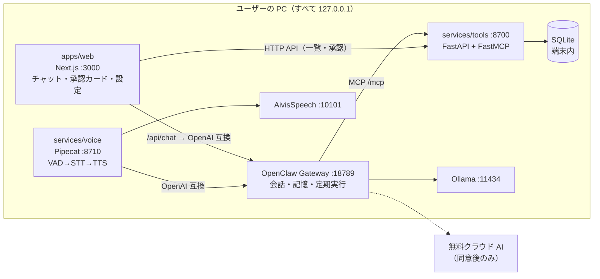

# 全体構成



## 主な流れ
1. **文字の会話**: 画面 → `/api/chat`（サーバー側）→ OpenClaw `/v1/chat/completions` → 返答を画面に表示
2. **声の会話**: マイク → voice（VAD・STT）→ OpenClaw → TTS → 再生。文字起こしと返答は画面の会話にも出す（contracts/voice-events.md）
3. **タスク操作**: OpenClaw が MCP ツールを呼ぶ → 変更系は「承認待ち」を返す → 画面に承認カード → 承認 API → 実行
4. **ブリーフ**: 起動時・設定時刻に、ブリーフ用ツールでまとめた内容を OpenClaw が文章化 → 画面表示と読み上げ

## 承認の設計
OpenClaw 自体の承認機能は Control UI 向けのため使わない。**承認は自作ツール側で実装する**:
変更系ツールは実行せずに `pending_id` を返す → 画面が承認カードを出す → `POST /approvals/{id}` で実行。

## データ設計・ツール仕様
DT-3-1 の仕様案（2026-11-05・全員で確認中）。実装は DT-4-1・DT-4-2（MCP）、DT-4-3（画面用 HTTP API）、DT-5-1（承認）。

### 決めごと
| 項目 | 決めたこと | 理由 |
|---|---|---|
| ID | 数字の連番（`INTEGER PRIMARY KEY`） | AI や声で「3 番のタスク」と指しやすい。PC 1 台の中だけで使う |
| 日付 | `YYYY-MM-DD` の文字列 | 期限は「日」で十分。時差の問題が起きない |
| 時刻 | ISO 8601 の文字列で、時差を付ける（例: `2026-11-05T09:00:00+09:00`） | 文字列のまま並べ替えでき、日付がずれない |
| 「今日」 | PC のタイムゾーンで決める | ブリーフの「今日の予定」をユーザーの感覚と合わせる |
| 削除 | 本当に消す（ゴミ箱に残さない） | データの方針「いつでも全部消せる」 |
| 文字数 | タイトル 1〜100 文字、メモ 0〜1000 文字、場所 0〜100 文字（前後の空白は除く） | 声で読み上げられる長さ。AI の書き間違いで巨大な値が入るのを防ぐ |
| 古い DB との互換 | `PRAGMA user_version` で版を持ち、起動時に足りない分だけ作り直す | 3 人の PC の DB を消さずに更新する |
| 接続 | `db.connect()` だけを使う（services/tools/CLAUDE.md） | p6 の暗号化を 1 か所で入れるため |

### テーブル
```sql
-- 版 1
CREATE TABLE tasks (
  id           INTEGER PRIMARY KEY,
  title        TEXT    NOT NULL CHECK (length(trim(title)) BETWEEN 1 AND 100),
  notes        TEXT    NOT NULL DEFAULT '' CHECK (length(notes) <= 1000),
  due_date     TEXT             CHECK (due_date IS NULL OR date(due_date) IS due_date),
  status       TEXT    NOT NULL DEFAULT 'open' CHECK (status IN ('open', 'done')),
  created_at   TEXT    NOT NULL,
  updated_at   TEXT    NOT NULL,
  completed_at TEXT,
  CHECK ((status = 'done') = (completed_at IS NOT NULL))
);
CREATE INDEX tasks_status_due ON tasks (status, due_date);

CREATE TABLE events (
  id           INTEGER PRIMARY KEY,
  title        TEXT    NOT NULL CHECK (length(trim(title)) BETWEEN 1 AND 100),
  notes        TEXT    NOT NULL DEFAULT '' CHECK (length(notes) <= 1000),
  location     TEXT    NOT NULL DEFAULT '' CHECK (length(location) <= 100),
  start_at     TEXT    NOT NULL,             -- 終日なら YYYY-MM-DD、それ以外は時差付きの時刻
  end_at       TEXT,                         -- なくてよい。あれば start_at 以降
  all_day      INTEGER NOT NULL DEFAULT 0 CHECK (all_day IN (0, 1)),
  status       TEXT    NOT NULL DEFAULT 'scheduled' CHECK (status IN ('scheduled', 'done')),
  created_at   TEXT    NOT NULL,
  updated_at   TEXT    NOT NULL,
  completed_at TEXT,
  CHECK ((status = 'done') = (completed_at IS NOT NULL)),
  CHECK (end_at IS NULL OR end_at >= start_at)
);
CREATE INDEX events_start ON events (start_at);

-- 承認待ち（DT-5-1 で使う。形だけ先に決める）
CREATE TABLE pending_actions (
  id          INTEGER PRIMARY KEY,
  action      TEXT NOT NULL CHECK (action IN (
                'add_task', 'complete_task', 'delete_task',
                'add_event', 'complete_event', 'delete_event')),
  payload     TEXT NOT NULL CHECK (json_valid(payload)),  -- ツールの引数そのまま
  summary     TEXT NOT NULL,                              -- 承認カードと読み上げに使う日本語の 1 文
  status      TEXT NOT NULL DEFAULT 'pending'
                CHECK (status IN ('pending', 'approved', 'rejected', 'expired', 'failed')),
  created_at  TEXT NOT NULL,
  expires_at  TEXT NOT NULL,                              -- 作ってから 10 分
  resolved_at TEXT,
  result      TEXT CHECK (result IS NULL OR json_valid(result))  -- 実行結果、または失敗の理由
);
CREATE INDEX pending_actions_status ON pending_actions (status, created_at);
```
- 時刻の列は、アプリが ISO 8601（時差付き）で入れる。SQLite の `CHECK` では形までは確かめない（入口の Pydantic で確かめる）
- `end_at >= start_at` の比較は、どちらも同じ時差で保存する前提（アプリが PC のタイムゾーンにそろえて入れる）

### MCP ツール（OpenClaw の AI が使う）
| ツール | 引数 | 返すもの | 種類 |
|---|---|---|---|
| `list_tasks` | `status`: `open`（既定）/ `done` / `all`、`due_on_or_before`: 日付（省略可） | タスクの一覧（期限の近い順、期限なしは最後） | 読む |
| `add_task` | `title`、`due_date`（省略可）、`notes`（省略可） | 変更の結果（下） | 変える |
| `complete_task` | `task_id` | 変更の結果 | 変える |
| `delete_task` | `task_id` | 変更の結果 | 変える |
| `list_events` | `from_date`・`to_date`: 日付（省略すると今日だけ） | 予定の一覧（始まりの早い順） | 読む |
| `add_event` | `title`、`start_at`、`end_at`（省略可）、`all_day`（既定 false）、`location`・`notes`（省略可） | 変更の結果 | 変える |
| `complete_event` | `event_id` | 変更の結果 | 変える |
| `delete_event` | `event_id` | 変更の結果 | 変える |
| `get_brief` | なし | 今日の予定・今日までのタスク・期限切れのタスク（DT-5-2 で A が作る） | 読む |

- 一覧は最大 50 件。それより多いときは `truncated: true` を付ける（声で読み上げきれないため）
- 引数の名前と docstring は、AI が迷わないように具体的に書く（例: 「`due_date` は `2026-11-05` の形。『明日』などは AI が日付に直してから渡す」）
- 完了・削除は ID で指定する。名前で指定されたら、AI が先に一覧で ID を調べる（同じ名前が複数あるときは AI がユーザーに聞き返す）

**変更の結果の形**（p4 と p5 で `status` だけが変わる。画面と音声は両方に対応しておく）
```json
// p4（DT-4-2）: すぐ実行する
{ "status": "done", "summary": "タスク「牛乳を買う」を追加しました", "item": { "id": 3, "title": "牛乳を買う", "...": "..." } }
// p5（DT-5-1）から: 実行せず承認を待つ
{ "status": "pending", "summary": "タスク「牛乳を買う」を追加します。よろしいですか？", "pending_id": 7 }
```

**エラーの形**: FastMCP の `ToolError` を、次の形の日本語メッセージで投げる。AI はそれを読んで、ユーザーに言い直す。
| 種類 | 例 |
|---|---|
| `invalid_argument` | `invalid_argument: タイトルは 1〜100 文字にしてください` |
| `not_found` | `not_found: タスク 12 は見つかりません。list_tasks で ID を確かめてください` |
| `conflict` | `conflict: タスク 3 はすでに完了しています` |
| `internal` | `internal: 保存に失敗しました`（原因はサーバーのログにだけ書く。ユーザーのデータは書かない） |

### 画面用 HTTP API（DT-4-3・A が作る）
MCP ツールと**同じリポジトリ層の関数**を呼ぶ（処理を二重に書かない）。形は FastAPI から `contracts/tools-api.json` に自動生成する。
| メソッドとパス | 中身 |
|---|---|
| `GET /tasks?status=open` ／ `POST /tasks` ／ `POST /tasks/{id}/complete` ／ `DELETE /tasks/{id}` | タスクの一覧・追加・完了・削除 |
| `GET /events?from=&to=` ／ `POST /events` ／ `POST /events/{id}/complete` ／ `DELETE /events/{id}` | 予定の一覧・追加・完了・削除 |
| `GET /approvals?status=pending` | 承認待ちの一覧（承認カード用。DT-5-1） |
| `POST /approvals/{id}/approve` ／ `POST /approvals/{id}/reject` | 承認して実行する／断る（DT-5-1） |

- **画面のボタンで行う変更は、承認カードを出さずにすぐ実行する**（ボタンを押すこと自体が承認）。承認カードが出るのは、AI（文字・声の会話）からの変更だけ
- エラーは HTTP の状態コード（400・404・409・500）と、`{"code": "not_found", "message": "日本語"}` で返す。種類は MCP と同じ
- 期限切れの承認待ち（10 分）は、承認しようとすると 409（`conflict: 承認の期限が切れました`）

### 確認してほしい点（A・B）
1. 予定の「完了」は要るか（MVP の条件「タスクと予定を追加・完了」に合わせて入れた。不要なら `complete_event` と `status` を外す）
2. 画面のボタンからの変更は承認なしで実行してよいか
3. 承認待ちの期限 10 分は短すぎないか（声で「はい」と言うまでの時間）
4. 一覧の最大 50 件・タイトル 100 文字で足りるか
5. 変更の結果の `summary` を、承認カードの文と読み上げの文に、そのまま使えるか
