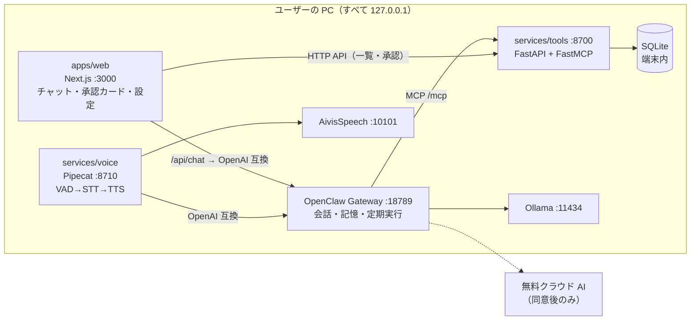

# 全体構成

## 主な流れ
1. **文字の会話**: 画面 → `/api/chat`（サーバー側）→ OpenClaw `/v1/chat/completions` → 返答を画面に表示
2. **声の会話**: マイク → voice（VAD・STT）→ OpenClaw → TTS → 再生。文字起こしと返答は画面の会話にも出す（contracts/voice-events.md）
3. **タスク操作**: OpenClaw が MCP ツールを呼ぶ → 変更系は「承認待ち」を返す → 画面に承認カード → 承認 API → 実行
4. **ブリーフ**: 起動時・設定時刻に、ブリーフ用ツールでまとめた内容を OpenClaw が文章化 → 画面表示と読み上げ

## 承認の設計
OpenClaw 自体の承認機能は Control UI 向けのため使わない。**承認は自作ツール側で実装する**:
変更系ツールは実行せずに `pending_id` を返す → 画面が承認カードを出す → `POST /approvals/{id}` で実行。

## データ設計・ツール仕様
（DT-2-1 で記入する: テーブル定義、ツール一覧と引数、エラー時の返し方）
